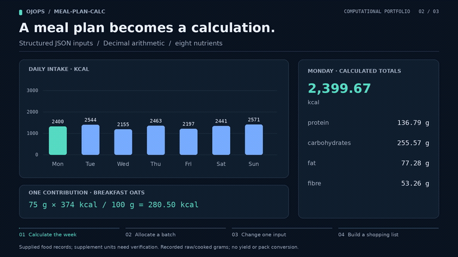

# Meal Plan Calculator

Calculate daily nutrition and shopping quantities from a configurable, repeating meal plan.

[](https://raw.githubusercontent.com/ojops/meal-plan-calc/45d36fb767beec954759e319df599bb409524fab/docs/media/demo.mp4)

*Preview: nutrition calculated from the supplied data. [Watch the full 36-second demonstration (MP4)](https://raw.githubusercontent.com/ojops/meal-plan-calc/45d36fb767beec954759e319df599bb409524fab/docs/media/demo.mp4) · [How the video is made](docs/DEMO.md).*

## Features

- Calculate calories, fat, saturates, carbohydrates, sugars, fibre, protein and salt
- Configure foods, meals and exercise schedules using JSON
- Distribute cooked batches across subsequent lunches and dinners
- Report shopping quantities for arbitrary periods, based on food **prepared** or **eaten**
- Validate inputs and retain precision using Python `Decimal`

Nutrition targets and ingredient optimisation are **planned, not implemented**.

## Install

Requires Python 3.10 and [uv](https://docs.astral.sh/uv/). These commands target Ubuntu or WSL:

```bash
git clone https://github.com/ojops/meal-plan-calc.git
cd meal-plan-calc
uv sync --locked
```

## Run

```bash
uv run meal-plan-calc
uv run meal-plan-calc --report nutrition
uv run meal-plan-calc --days 14 --report shopping
uv run meal-plan-calc --start-day monday --days 3 --report shopping
uv run meal-plan-calc --start-day thursday --days 4 --report shopping
```

By default, the program reports daily nutrition and a week of **prepared** shopping. Add `--shopping-basis eaten` to count ingredients consumed, including portions cooked on earlier days.

Edit `data/foods.json` and `data/meals.json`, or specify alternative files with `--foods`, `--meals` and `--schedule`. See `uv run meal-plan-calc --help` for more options.

## Calculation assumptions

Lunch uses the previous day's batch; dinner uses the batch from two days earlier. Category fractions determine how much of each batch goes to each meal. Nutrients are listed per 100 g, and ingredient quantities retain each food's recorded **raw or cooked state**. No cooking-yield or purchase-pack conversion is performed; supplement units still need checking.

The main calculations are in `src/meal_plan_calc/nutrition.py`, `planning.py` and `shopping.py`. See [calculation notes](docs/CALCULATIONS.md) for formulas and schedule rules.

## Planned roadmap

- **Validate inputs:** audit nutrient sources, raw versus cooked weights and supplement units before using the totals to assess a diet.
- **Introduce configurable targets:** support energy and nutrient goals by day or exercise type, with absolute and percentage deviations from actual daily totals.
- **Make reports evaluative:** identify which meals and ingredients contribute most to target shortfalls or excesses, and compare proposed portion changes.
- **Optimise ingredient quantities:** minimise deviations from selected targets within user-defined portion, ingredient and meal-plan constraints.
- **Improve shopping accuracy:** add optional cooking-yield and purchase-pack conversions while keeping prepared and eaten quantities distinct.

## Development

```bash
uv run pytest
uv run ruff check .
uv run ruff format --check .
```

GitHub Actions runs tests and formatting checks. See [coding conventions](docs/STYLE.md). [MIT licensed](LICENSE).
